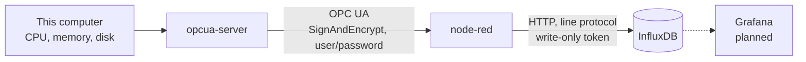

# packt-iiot-opcua-data-flow

[](https://github.com/natalia-stepanov-dev/packt-iiot-opcua-data-flow/actions/workflows/ci.yml)

An OPC UA server that publishes health data of the machine it runs on
(CPU load and temperature, memory, disk, uptime), and a Node-RED edge
that reads this data and writes it to InfluxDB.

I am building it during the Coursera specialization
[Hands-On Industrial Internet of Things](https://www.coursera.org/specializations/packt-hands-on-industrial-internet-of-things)
by Packt. The exercise of course 1 (Foundations of Industrial IoT) was the
starting point. What I changed and why is in
[docs/changes-from-course.md](docs/changes-from-course.md).

Status: the server, the edge and InfluxDB work. The edge writes all
values to InfluxDB. Dashboards are not done yet.

## Architecture



- `opcua-server/` - OPC UA server (Node.js, node-opcua)
- `node-red/` - Node-RED edge: settings, flow, tests
- `compose.yaml` - InfluxDB (Docker Compose)

## Requirements

- Linux (tested on Debian 12)
- Node.js 22.13 or newer (the project uses 24, see `.nvmrc`)
- For InfluxDB: Docker with the Compose plugin (tested with Docker 29.9.3
  and Compose 5.7.1)
- For CPU temperature: a hardware sensor (`coretemp`, `k10temp` or
  `cpu_thermal`). Without a sensor the value has the status
  `BadOutOfService`.

## Installation and start

```bash
git clone https://github.com/natalia-stepanov-dev/packt-iiot-opcua-data-flow.git
cd packt-iiot-opcua-data-flow
nvm use   # only if you use nvm
```

OPC UA server:

```bash
cd opcua-server
npm ci
OPCUA_USER=gateway OPCUA_PASSWORD='<your password>' npm run dev
```

InfluxDB (in the repository folder):

```bash
cp .env.example .env
```

In `.env`, set the password and the admin token. Random values are fine:
`openssl rand -hex 32`. Then start the database:

```bash
docker compose up -d
```

The first start creates the user `admin`, the organization `iiot` and the
bucket `gateway`. The database is only reachable on http://127.0.0.1:8086.

Node-RED needs its own token that can only write to `gateway`. Find the
bucket ID and create the token:

```bash
docker compose exec influxdb influx bucket list --name gateway
docker compose exec influxdb influx auth create --org iiot \
  --write-bucket <bucket ID> --description node-red-write
```

InfluxDB shows the token only once. Put it into `.env` as
`INFLUX_NODERED_TOKEN`.

Node-RED (second terminal, in the repository folder, same user and
password, a device name and the token from `.env`):

```bash
npm install -g node-red@5.0.9
cd node-red
npm ci
INFLUX_NODERED_TOKEN="$(sed -n 's/^INFLUX_NODERED_TOKEN=//p' ../.env)" \
  OPCUA_USER=gateway OPCUA_PASSWORD='<your password>' GATEWAY_DEVICE=laptop \
  node-red -u .
```

The command takes only this token from `.env`, so Node-RED does not get
the admin token. Then open http://127.0.0.1:1880.

To see the data, open Data Explorer on http://127.0.0.1:8086: bucket
`gateway`, field `value`.

## Configuration

| Variable               | Used by          | Default  | Description                                 |
| ---------------------- | ---------------- | -------- | ------------------------------------------- |
| `OPCUA_USER`           | server, Node-RED | required | OPC UA user name                            |
| `OPCUA_PASSWORD`       | server, Node-RED | required | OPC UA password                             |
| `GATEWAY_DEVICE`       | Node-RED         | required | Device name in the data: A-Z a-z 0-9 \_ . - |
| `INFLUX_NODERED_TOKEN` | Node-RED         | required | InfluxDB token, can only write to `gateway` |
| `OPCUA_PORT`           | server           | 26543    | OPC UA port                                 |
| `LOG_LEVEL`            | server           | info     | Log level                                   |

The server stops with an error if the user name or password is missing.
Node-RED stops with an error if `GATEWAY_DEVICE` is missing or uses other
characters, or if `INFLUX_NODERED_TOKEN` is missing.

InfluxDB reads its settings from `.env`, see `.env.example`.

## Data

Namespace URI: `urn:iiot-edge-gateway`. Find the namespace index by this
URI in `NamespaceArray` (`ns=0;i=2255`). Do not use a fixed index.

| NodeId (`s=...`)          | Type              | Unit |
| ------------------------- | ----------------- | ---- |
| `Gateway.Cpu.Usage`       | AnalogItem, 0-100 | %    |
| `Gateway.Cpu.Temperature` | AnalogItem, 0-125 | °C   |
| `Gateway.Memory.Usage`    | AnalogItem, 0-100 | %    |
| `Gateway.Disk.Usage`      | AnalogItem, 0-100 | %    |
| `Gateway.Uptime`          | AnalogUnitType    | s    |

All nodes are read-only. Disk usage is measured for `/`.

Security mode: `SignAndEncrypt`. Security policies: `Basic256Sha256`,
`Aes128_Sha256_RsaOaep`, `Aes256_Sha256_RsaPss`. The server also lists an
endpoint with `None`, but only to show its addresses. A session with
`None` is not possible.

## Tests

```bash
(cd opcua-server && npm test)
(cd node-red && npm test)
```

The server tests start their own server on port 26544. They can run
while `npm run dev` is running. The temperature test is skipped on
machines without a sensor.

GitHub Actions runs these tests on every push to `main` and on pull
requests, together with lint, the format check (server only) and
`npm audit --omit=dev`. See `.github/workflows/ci.yml`.

## Known limitations

- The server accepts every client certificate. The connection is
  encrypted and needs a password, but the client is not checked.
- The Node-RED editor has no password. It is only reachable on
  `127.0.0.1`. Do not make port 1880 reachable from a network.
- node-red-contrib-opcua writes the OPC UA password to the log when a
  connection fails. `node-red/settings.js` replaces the password with
  `***` in the Node-RED log.
- node-red-contrib-opcua 0.2.355 uses an old node-opcua version with known
  vulnerabilities. `node-red/package.json` replaces it with 2.187.18
  (`overrides`). Check this after every update of the plugin.
- The OPC UA address in the flow is fixed: `opc.tcp://localhost:26543`.
- With the commands above, the OPC UA password stays in the shell history.
  The InfluxDB secrets and the Node-RED token come from `.env`. The OPC UA
  password will move there with Docker Compose.
- Node-RED writes to InfluxDB directly and has no buffer. If InfluxDB
  cannot be reached, the points are lost. The flow logs the first error
  and, when writing works again, how many points were not written. The
  http request node itself also logs an error for every point.

## Next steps

- Docker Compose for the server and Node-RED
- A buffer between the edge and InfluxDB: MQTT and Telegraf
- Grafana dashboards and alerts

## License

- `opcua-server/` is based on the course code: MIT License, Etienne
  Rossignon (`opcua-server/LICENSE`).
- All other code: MIT License, Natalia Stepanov (`LICENSE`).
